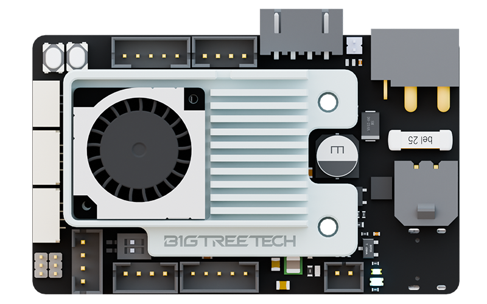
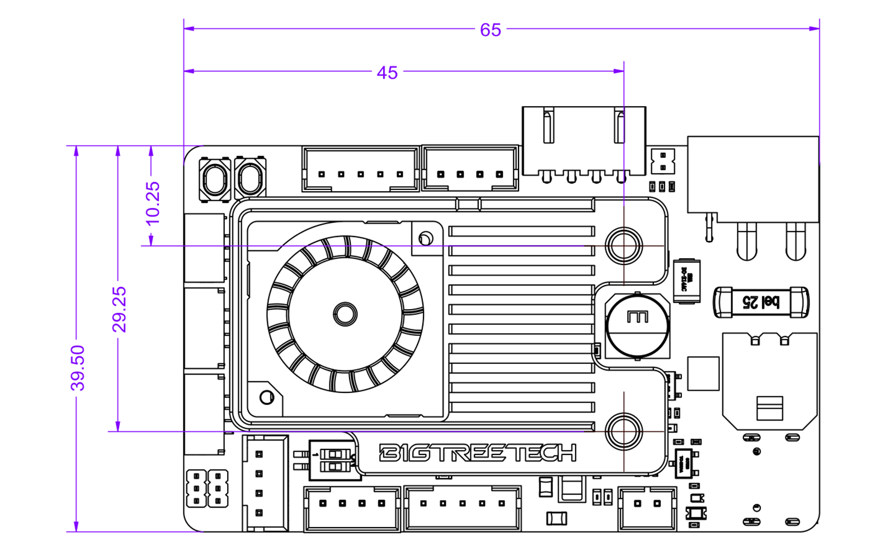
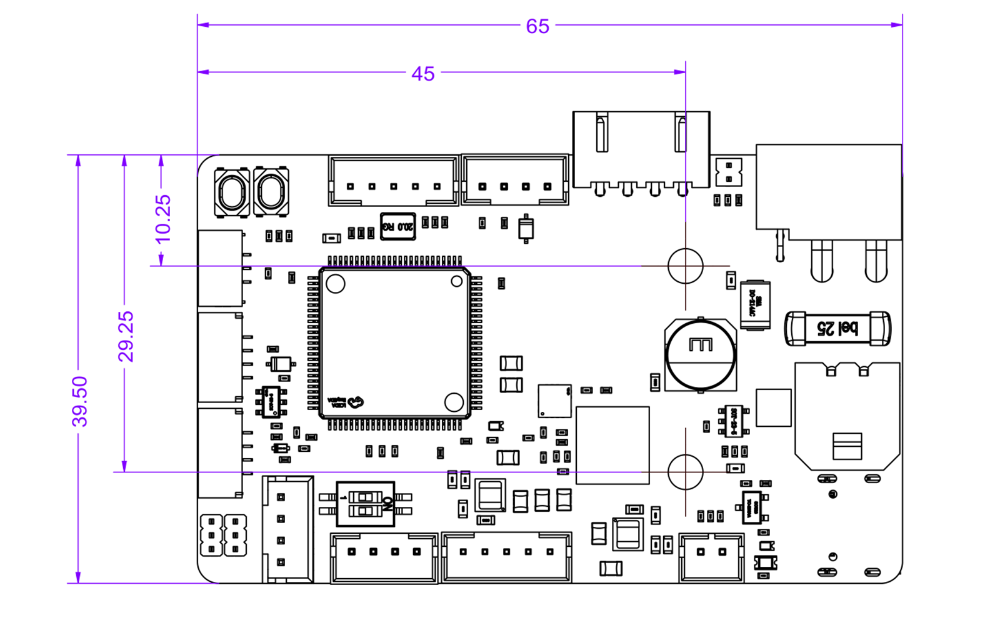
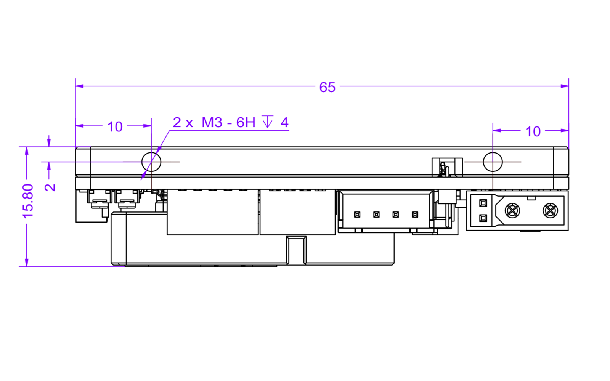
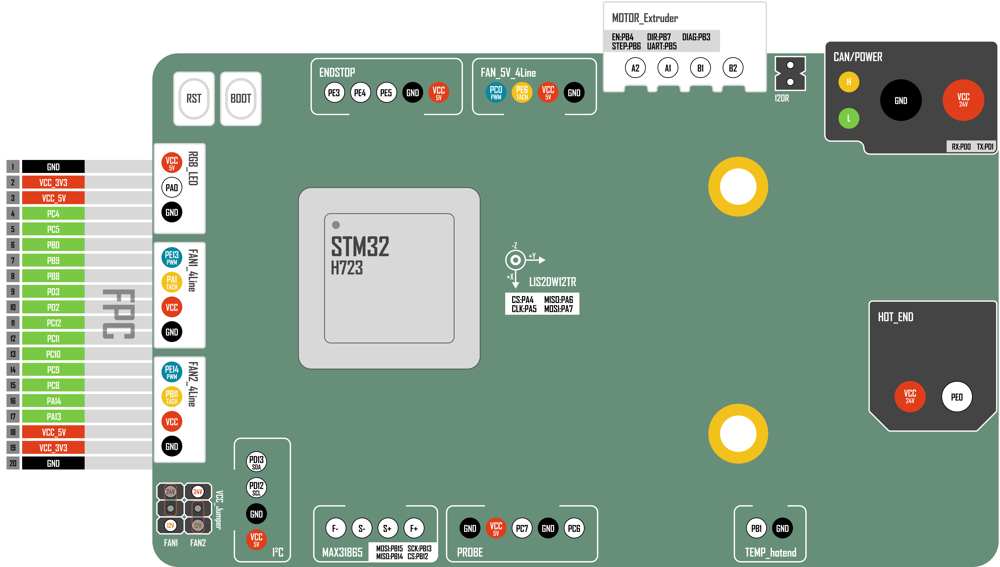

# EBB PRO R1

> [!tip]
> [Bigtreetech Wiki NEO | EBB PRO R1](https://neo.bttwiki.com/docs/board-docs/ebb-series/ebb-pro-r1/)

## Hardware

### Dimensions

### 3D STEP

- [EBB PRO R1 3D STEP](./hardware/step/ebb-pro-r1-release.zip)
- [EBB PRO R1 Backplate Template](./hardware/step/ebb-pro-r1-backplate-template.STEP)

### Pinout / Schematic

- [EBB PRO R1 Pinout](./hardware/schematic/ebb-pro-r1-pinout-release.webp)
- [EBB PRO R1 Schematic](./hardware/schematic/ebb-pro-r1-schematic-release.pdf)

## Firmware

- [EBB PRO R1 Klipper Config](./firmware/ebb-pro-r1-example.cfg)
